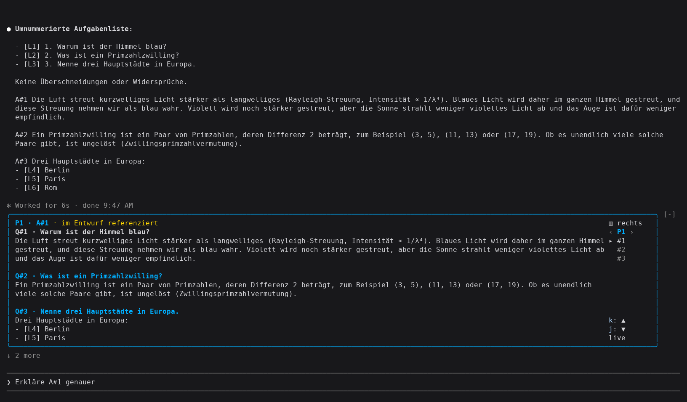
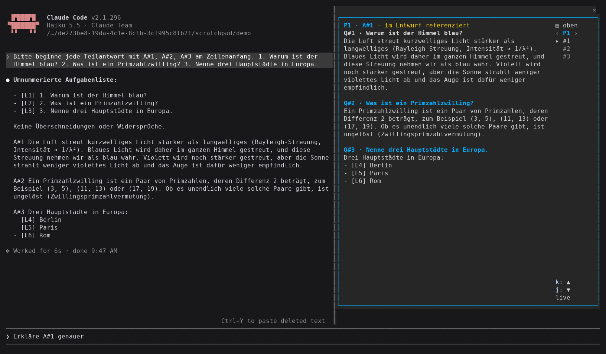
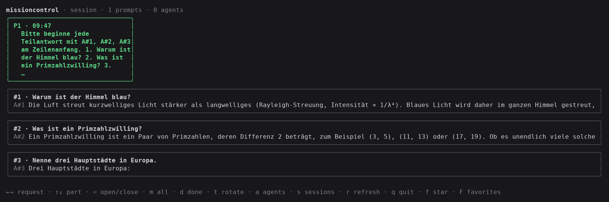

# MissionControl

**Claude schreibt Romane. Du wolltest eine Antwort.**

MissionControl ist ein TUI, das eine laufende Claude-Code-Session auf das
reduziert, was du wissen wolltest: deine eigenen Prompts, die numerierten
Teilfragen darin — und was davon schon beantwortet ist.

Kein Scrollen durch Denk-Monologe, Tool-Logs und Zwischenberichte. Du siehst
deine Frage, und du siehst die Antwort. Der Rest bleibt, wo er hingehört.

## Neu: Jetzt auch als Mod!

MissionControl läuft jetzt direkt in Claude Code: als Mod, ohne TUI, ohne Go,
ohne zweites Terminal. Über der Eingabe steht genau ein Paar — deine Frage und
Claudes Antwort darauf.



- **Eine Frage, eine Antwort.** Der Mod zeigt die Teilfrage `Q#n` und den
  `A#n`-Abschnitt, der sie beantwortet. Die Frage bleibt oben stehen, während du
  durch die Antwort scrollst — bis das nächste Paar kommt.
- **`A#3` tippen genügt.** Schreibst du `A#3` in die Eingabe, springt der Mod
  schon beim Tippen auf dieses Paar. Beim Absenden geht genau diese Frage und
  Antwort als Kontext mit, nicht der ganze Prompt. `P2 A#3` holt ein älteres.
- **Live.** Ohne Referenz folgt der Mod dem Teil, den Claude gerade beantwortet.
- **Oben oder rechts.** `▥ rechts` legt den Mod als Spalte neben den Chat, in
  voller Höhe; `▤ oben` holt ihn zurück.
- **Steuerung.** Mausrad, Pfeiltasten (nach `ctrl+x tab`) oder `k`/`j`; rechts
  `‹ P ›` für den Prompt, `#n` für das Paar, `live` zurück zum aktuellen.



Der Mod braucht nichts außer Claude Code: Er liest das Transcript der Session
selbst und zerlegt es nach denselben Regeln wie das TUI.

### Mod installieren

In Claude Code (ab 2.1.275):

```
/plugin install missioncontrol --marketplace BeMuCa/missioncontrol
```

`y` fügt den Marketplace hinzu, Enter wählt den User-Scope: Der Mod ist dann in
jeder neuen Session aktiv, in jedem Projekt.

Die `A#n`-Marker schreibt Claude nur, wenn man es darum bittet. Damit der Mod
deine Teilfragen mit ihren Antworten zusammenbringt, gehört das in die
`~/.claude/CLAUDE.md`:

```markdown
## Multi-part prompts
When a prompt contains several numbered questions or tasks, begin the answer to
each part with `A#<n>` at the start of a line, using the prompt's own numbering.
Everything up to the next marker belongs to that part.
```

### Den Mod in ein beliebiges Repo aufnehmen

So teilst du ihn über das Repo eines anderen Projekts mit deinem Team:

1. Den Ordner [`mod/`](mod/) ins andere Repo kopieren, z. B. nach
   `tools/missioncontrol/`.
2. Im Root des anderen Repos `.claude-plugin/marketplace.json` anlegen:

   ```json
   {
     "name": "team-tools",
     "owner": { "name": "Dein Team" },
     "plugins": [{ "name": "missioncontrol", "source": "./tools/missioncontrol" }]
   }
   ```

3. Die Kollegen installieren mit

   ```
   /plugin install missioncontrol --marketplace <owner>/<repo>
   ```

   `<owner>/<repo>` ist der GitHub-Pfad des anderen Repos
   (`github.com/<owner>/<repo>`), nicht der `owner` aus der `marketplace.json` —
   der ist nur ein Anzeigename. Statt eines GitHub-Pfads geht auch eine Git-URL.

Nur ausprobieren, ohne zu installieren: `claude --plugin-dir <pfad>/mod`.

## Was es zeigt

Der Board-Baum hat drei Ebenen, direkt aus dem Session-Transcript gelesen:

- **Prompts** — was du getippt hast, in der Reihenfolge, in der du es getippt hast.
- **Items** — die numerierten Teile eines Prompts. `1. mach X`, `2) dann Y`,
  `3- und Z` werden alle erkannt, auch mitten in der Zeile (`… fertig? 2. dann das`),
  damit deine Nummerierung nicht darüber entscheidet, ob das Board deine Teile sieht.
- **Agents** — welche Subagents ein Prompt gestartet hat und welche davon fertig sind.

Dazu: Favoriten für Antworten, die du behalten willst, und Done-Marker für Teile,
die abgehakt sind.



## Installation

```sh
go install github.com/BeMuCa/missioncontrol/cmd/missioncontrol@latest
```

Gebaut gegen Go 1.26.

## Von überall starten

Ein Projekt einmal anmelden:

```sh
cd ~/git/meinprojekt
missioncontrol init
```

Danach startet `missioncontrol` von jedem Verzeichnis aus im Projekt-Launcher:
Logo, Wordmark, darunter jedes angemeldete Projekt mit Sessionzahl und letzter
Aktivität. Der Schriftzug steht einzeilig und braucht dafür 85 Spalten; darunter
zeigt der Launcher den Namen als schlichten Text. Enter öffnet das Board auf der neuesten Session, `esc` führt vom Board
zurück zur Liste.

Wurde `missioncontrol` in einem angemeldeten Projekt gestartet, steht die
Auswahl schon darauf — Enter genügt.

Die Registrierung liegt in `~/.missioncontrol/projects.json`, neben `~/.claude`.
Sie enthält nichts als Pfade: die Sessions eines Projekts werden aus seinem Pfad
gefunden, nicht aus der Datei. Die Datei zu löschen kostet nur die Abkürzungen.
`missioncontrol forget` nimmt das aktuelle Verzeichnis wieder heraus.

## Benutzung

```sh
missioncontrol              # Launcher: Projekt wählen, dann Board
missioncontrol -here        # Launcher überspringen, Session in diesem Verzeichnis
missioncontrol init         # dieses Verzeichnis anmelden
missioncontrol forget       # dieses Verzeichnis wieder abmelden
```

| Flag | Wirkung |
|---|---|
| `-here` | Launcher überspringen und die Session im aktuellen Verzeichnis öffnen |
| `-session <id>` | eine bestimmte Session beobachten |
| `-print` | Board einmal als Text rendern und beenden (für Skripte, Pipes, Hooks) |
| `-select <id>` | mit `-print`: eine Zeile vorauswählen (`P3`, `P3.2`, `A7`) |
| `-stacked=false` | Split-Layout statt der rotierten Ansicht |

`-here`, `-session` und `-print` benennen jeweils genau ein Board und gehen
deshalb am Launcher vorbei — eine Pipe hat niemanden, der aus einer Liste wählt.

## Tasten

**Launcher**

| Taste | Aktion |
|---|---|
| `j` `k` / `↑` `↓` | Projekt wechseln |
| `enter` | Board auf der neuesten Session öffnen |
| `r` | Liste neu einlesen |
| `g` `G` | an den Anfang / an das Ende |
| `q` `esc` | beenden |

**Board**

| Taste | Aktion |
|---|---|
| `j` `k` / `↑` `↓` | Zeile bzw. Box wechseln, im Textbereich scrollen |
| `h` `l` / `←` `→` | Prompt wechseln (stacked) bzw. zwischen Baum und Text springen (split) |
| `enter` | Box auf/zu; in der Favoritenansicht: Pfeiltasten an den Text übergeben |
| `t` | Layout umschalten (stacked ↔ split) |
| `m` | alle Boxen auf/zu (stacked) |
| `a` | Agents ein-/ausblenden |
| `f` | Favorit setzen/entfernen (in der Favoritenansicht: löschen) |
| `F` | Favoritenansicht öffnen/schließen |
| `d` | als erledigt markieren |
| `s` | Sessionliste öffnen |
| `r` | neu laden |
| `g` `G` | an den Anfang / an das Ende |
| `ctrl+d` `ctrl+u` | halbseitig scrollen |
| `q` `ctrl+c` | beenden |
| `esc` | offene Overlays schließen, sonst zurück zum Launcher (bzw. beenden, wenn ohne Launcher gestartet) |

## Wie es liest

Ein Session-Transcript ist eine JSONL-Datei, an die während der Session
angehängt wird; jeder Subagent bekommt seine eigene JSONL daneben. MissionControl
liest inkrementell per Byte-Offset — die ganze Datei bei jedem Poll neu zu parsen
würde mit der Sessionlänge skalieren, und Sessions laufen stundenlang.

Zwei Dinge sind exakt aus den Daten ableitbar: zu welchem Prompt ein Agent gehört
(über die `promptId`) und ob er fertig ist (ein `tool_result` für seine
`toolUseId` existiert). Zwei sind es nicht: welchem numerierten Item ein Agent
dient, steht nirgends in den Daten — und ein Agent, dessen `promptId` zu keinem
getippten Prompt gehört, wird über die Zeit einsortiert.
